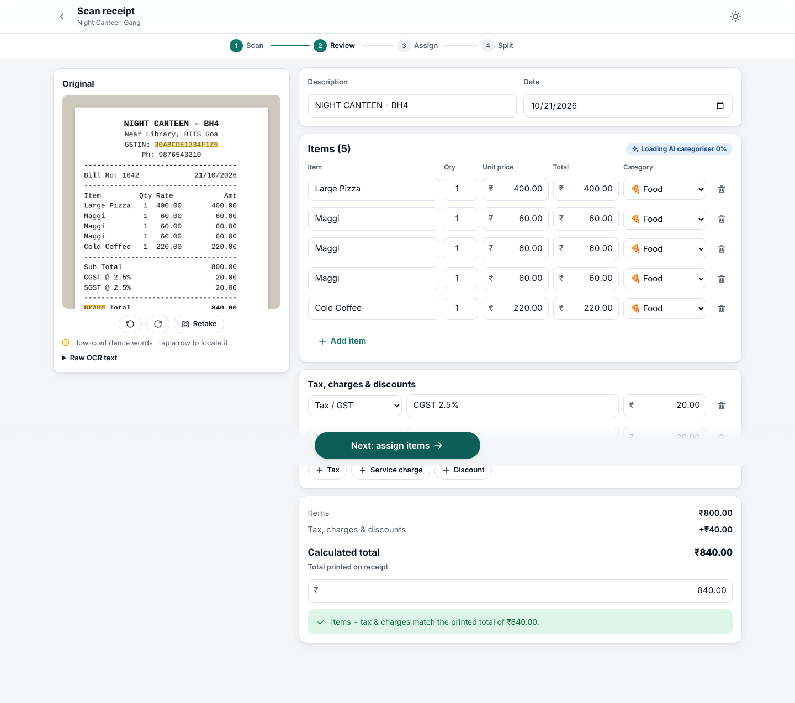
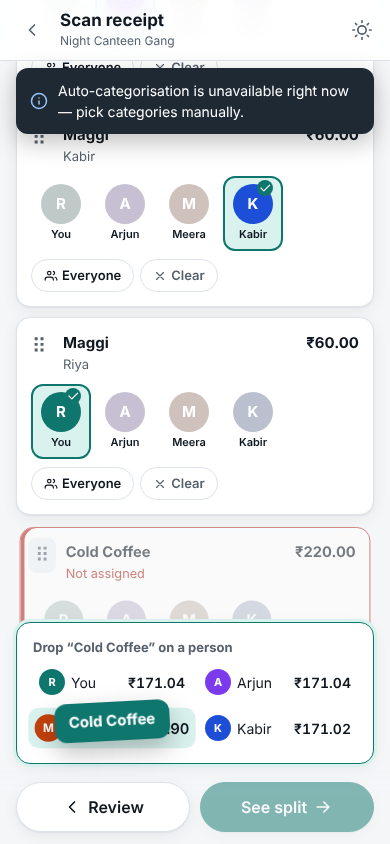
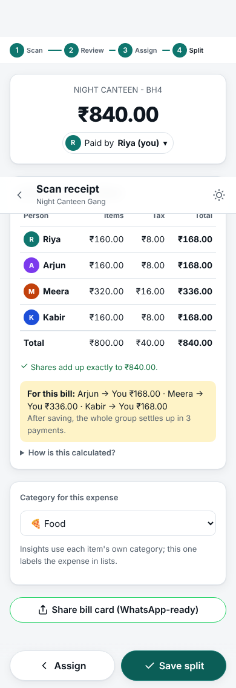
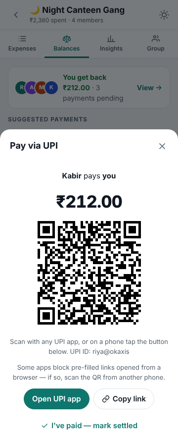
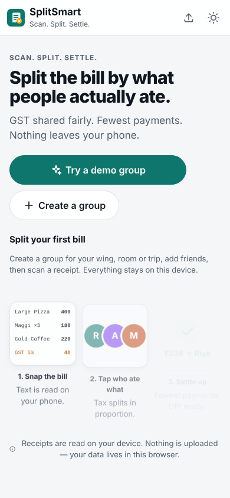
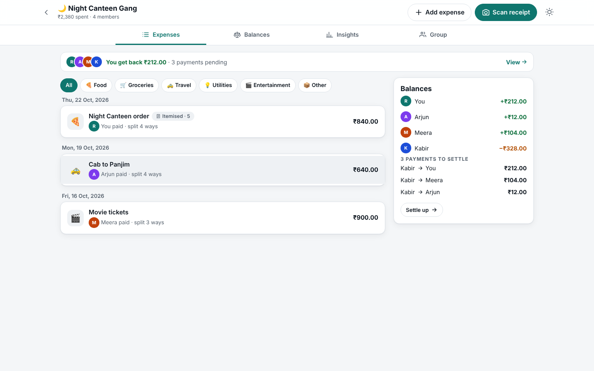
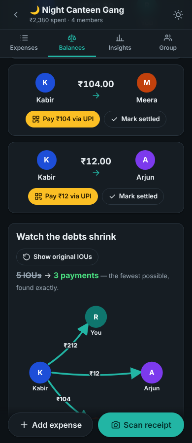
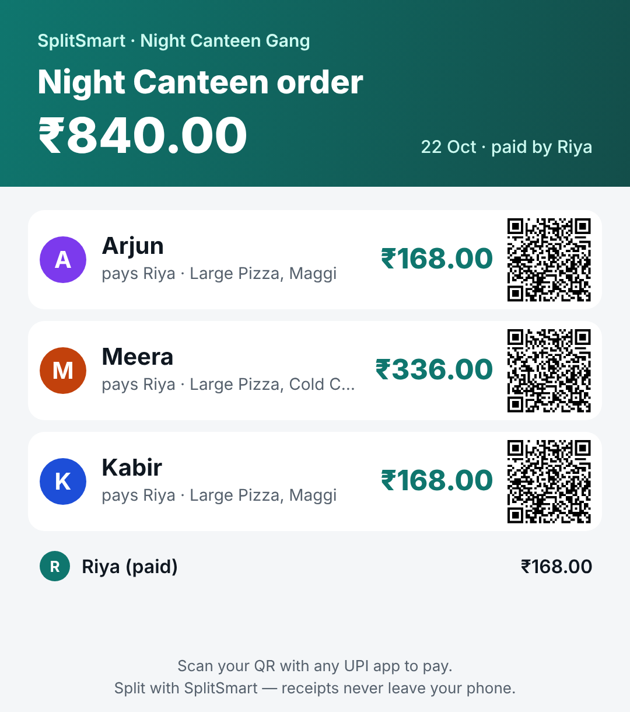

# SplitSmart

**Scan a receipt, assign items, split it fairly, settle up in as few payments as possible.**

SplitSmart is our Web Brawl GC 2026 entry. It is a static web app with no backend. Photos of receipts are read **on your device** with Tesseract.js. Items are categorised by an on-device zero-shot model, and every group, expense and settlement is stored in your browser.

| Review (desktop) | Assign (phone) | Split (phone) | UPI settle-up |
| --- | --- | --- | --- |
|  |  |  |  |

| Welcome | Group (desktop) | Watch the debts shrink | Shareable bill card |
| --- | --- | --- | --- |
|  |  |  |  |

---

## Quick start

```bash
npm install
npm run dev        # http://localhost:5173
npm test           # unit tests for money, split, settlement, parser, sharing, analytics
npm run build      # production build in dist/ (static, deploy anywhere)
npm run samples    # regenerate the sample receipts in samples/ (needs Playwright + Chromium)
```

Requires Node 18+. `npm run dev` and `npm run build` first copy the OCR engine and English model from `node_modules` into `public/ocr/` (see `scripts/copy-ocr-assets.mjs`). This means OCR is served from our own origin and never depends on a third-party CDN.

**Deploying:** pushing to `main` runs `.github/workflows/deploy.yml`, which tests, builds and publishes to GitHub Pages. Enable it once under *Settings → Pages → Source: GitHub Actions*. The build uses a relative base path and hash routing, so the same `dist/` folder also works on Netlify or Vercel.

**Try it in 10 seconds:** open the app, tap **Try a demo group**, or scan one of the images in [`samples/`](samples).

---

## Models used (all pretrained, used as-is, run client-side)

| Purpose | Model | Notes |
| --- | --- | --- |
| OCR | **Tesseract.js v5** with the English LSTM model (`@tesseract.js-data/eng`, `4.0.0_best_int`) | Runs in Tesseract's own Web Worker. Loaded only on the first scan, then cached (IndexedDB + service worker). |
| Item categorisation | **`Xenova/mobilebert-uncased-mnli`** via Transformers.js (zero-shot classification) | Runs in our own Web Worker (`src/workers/classifier.worker.ts`). Loaded lazily on first use and cached by the browser. It never blocks the first screen. |

No training or fine-tuning, no paid APIs, no API keys. Receipt images never leave the device and are not even stored: only the parsed items are saved.

---

## Features by tier

### Tier 1 — core ✅
- **Groups & members:** create, rename and delete groups (with an emoji). Add and remove members with a colour, emoji avatar and optional UPI ID. A dashboard switches between groups and shows totals.
- **Receipt capture:** upload JPG/PNG, drag & drop, or use the live camera (`getUserMedia`, rear camera). There is a preview with rotate and retake before processing.
- **OCR with progress:** canvas preprocessing (grayscale plus local adaptive contrast for faded thermal paper), then Tesseract with a staged progress bar. The UI stays responsive.
- **Line-item parsing:** item name, quantity, unit price and line total. Detects subtotal, CGST/SGST/IGST/VAT/cess, service charge, discount, round-off, packing/delivery charges and the grand total. Ignores GSTIN, phone numbers, bill numbers, dates, addresses, tendered cash and change, and footers.
- **Review & correction:** every field is editable and lines can be added or deleted. Words with low OCR confidence (< 70%) are **highlighted yellow**, both in the table and as boxes on the original image. The image sits beside the table on desktop and above it on phones. Tapping a row outlines its line on the image.
- **Total validation:** a warning shows when items + charges ≠ the printed total, with the exact difference and one-tap fixes ("add the difference as a line" or "use the calculated total").
- **Manual expenses:** description, amount, payer, participants, date and category.
- **Balances:** each member's net balance (owes / is owed, with paid vs share), recalculated after every change.

### Tier 2 — advanced ✅
- **Itemized assignment:** tap avatars on each item, or "Everyone". Shared items are split among their assignees. Unassigned items are flagged red and block saving.
- **Four split modes:** equal, exact ₹, percentages and shares (2 : 1 : 1). Percentages must total 100% and exact amounts must total the bill, with live feedback.
- **Proportional tax, charges and discounts:** shared by each person's item subtotal (₹600 of a ₹1,000 bill pays ₹60 of the ₹100 tax).
- **Rounding reconciliation:** shares always add up to the bill exactly, to the paisa (see the rule below).
- **Debt simplification:** a provably minimal number of payments (see below), "Mark settled" with undo, and a settlement history.
- **Auto-categorisation:** Food / Groceries / Travel / Utilities / Entertainment / Other, per item. Any category can be overridden. The model loads lazily and can be switched off.
- **Persistence:** everything is in `localStorage` (zustand `persist`) and survives refreshes.

### Tier 3 — brownie points ✅
- **UPI settle-up:** a `upi://pay` deep link (payee VPA, name, amount, note) and a QR code for every suggested payment.
- **Spending analytics:** by category (donut), by member (paid vs share) and over time. Drawn with plain SVG/CSS, so no chart library is downloaded.
- **Sharing without a backend:** JSON export/import, and a share link with the whole group compressed (deflate + base64url) inside the URL fragment.
- **PWA & offline:** installable. The app shell is precached. OCR assets and model weights are cached on first use, so later scans work offline.
- **Recurring expenses:** weekly or monthly (e.g. Wi-Fi recharge). Each occurrence is created automatically when due, and templates can be paused or deleted.
- **Export:** settlement summary as **PDF** (jsPDF, lazy-loaded) or **CSV**.
- **Multi-receipt batch scan:** select several photos at once and review them one after another.
- **Accessibility:** semantic landmarks, skip link, labelled controls, `<dialog>` modals with Esc and focus handling, visible focus rings, `prefers-reduced-motion`, AA-contrast colours, and light/dark/system themes.
- **Robustness extras:** auto-orientation (if a read is poor, the 90° and 270° rotations are tried and the best is kept), a raw-OCR-text viewer, a "no items found" path to manual entry, and a camera-denied fallback to upload.
- **Real-receipt OCR:** item names printed on one line with `qty price amount` on the next are joined; images are upscaled so compressed phone photos read well; GST keywords survive OCR digit swaps (`6ST`, `SG5T`); one-tap 5/12/18% GST, and the app spots a missing GST slab when the total doesn't add up.

### Original features (beyond the brief)
- **"You" everywhere:** your name is asked once and remembered. Balances read "You get back ₹672" / "You owe Riya ₹168", you're the default payer, and imported groups ask "Which one is you?".
- **Watch the debts shrink:** an animated graph on Balances collapses every original IOU into the minimum set of payments ("5 IOUs → 3 payments"), making the settlement algorithm visible.
- **WhatsApp-ready bill card:** one tap draws an image of the split, with each person's share and a UPI QR to pay the payer, and opens the phone's share sheet (or downloads it).
- **Drag items onto faces:** in Assign, drag an item by its handle onto a person in the dock; the running totals count up. Tap-to-toggle remains for accessibility.
- **Consequence line:** the Split screen shows "For this bill: Arjun → You ₹168 · …" and how many payments the whole group needs after saving.
- **Polish:** first-run hero with the demo as the main action, a status strip ("You get back ₹212 · 3 payments pending → View"), a desktop two-column layout with live balances, step transitions, a sticky photo strip with tap-to-zoom on phones, amber for money you owe, a "?" badge on low-confidence fields, and confetti plus a short vibration when everyone is settled.

---

## How the money maths works

All amounts are stored as **integer paise**, so there is no floating-point drift anywhere. The logic lives in pure, UI-free modules in `src/lib/`.

### Rounding rule (largest remainder)
Implemented in `allocate()` in [`src/lib/split.ts`](src/lib/split.ts):

1. Work out each person's exact share as a fraction of the total (BigInt maths, so it stays exact for any amount).
2. Round every share **down** to a whole paisa.
3. Hand the leftover paise out one at a time to the people whose discarded fractions were **largest**.
4. **Ties go to whoever is listed first** in the group's member list.

Example: ₹100 ÷ 3 → **₹33.34, ₹33.33, ₹33.33**. The same rule is used for equal, percentage and share splits, for splitting a shared item between its assignees, and for spreading each tax, charge or discount line across people.

### Itemized split
1. Each item's line total is split equally among its assignees.
2. Each tax, service-charge, discount or round-off line is split **in proportion to each person's item subtotal**.
3. A person's share = items + their portion of every adjustment. These add up exactly to the bill.

### Debt simplification (minimum transactions)
Implemented in [`src/lib/settle.ts`](src/lib/settle.ts):

1. Reduce every expense and settlement to one **net balance** per person (paid − consumed ± settlements). The nets sum to zero.
2. If the n people with non-zero balances can be split into **k groups that each sum to zero**, each group can settle internally with (size − 1) payments, so **n − k** payments are enough, and that is the minimum. We find the largest k **exactly** with a bitmask dynamic programme (`dp[mask]` = most zero-sum groups that can be peeled off `mask`). It is O(2ⁿ·n) and instant for up to 18 people with open balances.
3. Inside each zero-sum group, the largest debtor pays the largest creditor, repeatedly. Every step clears at least one person, so a group of size s needs at most s − 1 payments.
4. Groups with more than 18 people who have open balances fall back to that greedy step (≤ n − 1 payments).

A plain greedy is **not** always optimal. For balances {+5, +4, −4, −3, −2} greedy needs 4 payments, but the optimum is 3 ({+4, −4} and {+5, −3, −2}). The tests check our result against brute force on 150 random cases, plus the "5 members, 10 mixed expenses" judging scenario.

### Receipt parsing
[`src/lib/receiptParser.ts`](src/lib/receiptParser.ts) is heuristic:
- It peels right-aligned numbers off each line and fixes OCR digit mix-ups (O→0, l→1, S→5).
- It classifies lines by keyword: noise → subtotal → total → round-off → discount → service → tax → other charges → item.
- It recovers quantity from "qty rate amount", "qty amount", "2 x Item" and "Item x2" layouts.
- It only accepts items before the summary block starts.
- It picks the strongest "grand total" keyword, and treats a lone "Total" followed by taxes as a subtotal.

It never throws. A bad read just gives fewer items for the user to fix.

---

## Project structure

```
src/
  lib/            # pure logic — no React, fully unit-tested
    money.ts        paise parsing/formatting
    split.ts        allocation, split modes, itemized split, rounding rule
    settle.ts       balances + minimum-transaction settlement
    receiptParser.ts OCR lines → items, charges, totals, confidences
    analytics.ts    category / member / timeline totals
    upi.ts, share.ts, recurring.ts, exporters.ts, demo.ts, types.ts
  services/       # browser integrations (lazy-loaded)
    ocr.ts          Tesseract.js wrapper with staged progress
    imagePrep.ts    rotation, scaling, adaptive contrast
    classifier.ts   main-thread client for the model worker
    pdf.ts, qr.ts
  workers/classifier.worker.ts   Transformers.js zero-shot model
  store/useStore.ts              zustand store persisted to localStorage
  screens/                       Dashboard, group tabs, expense editor, scan flow
  components/                    Avatar, Modal, MoneyInput, SplitEditor, Toasts…
tests/            # vitest unit tests
samples/          # test receipts: clear, faded, rotated, no-total, non-receipt
```

**Performance:** the first screen is about 70 KB of JS (gzip). OCR, the categoriser, PDF and QR code are separate chunks that load only when first needed.

## Robustness test cases (from the brief)

| # | Case | Behaviour |
| --- | --- | --- |
| 1 | Clear GST bill | `samples/restaurant-clear.png` parses fully and matches ₹840 |
| 2 | Faded thermal receipt | Adaptive contrast; low-confidence words highlighted yellow (`samples/canteen-faded.png`) |
| 3 | Rotated 90° | Auto-orientation retries 90°/270°; manual rotate and retake (`samples/restaurant-rotated.png`) |
| 4 | Selfie / non-receipt | "No items found" message plus manual entry (`samples/not-a-receipt.png`) |
| 5 | No printed total | Total computed from the items; user asked to confirm (`samples/grocery-no-total.png`) |
| 6 | ₹100 ÷ 3 | ₹33.34 / ₹33.33 / ₹33.33 (unit-tested) |
| 7 | Camera denied | Clear message; upload stays available |
| 8 | Offline after first visit | PWA shell plus cached OCR assets |
| 9 | 5 members, 10 mixed expenses | Minimum payments (unit-tested against brute force) |
